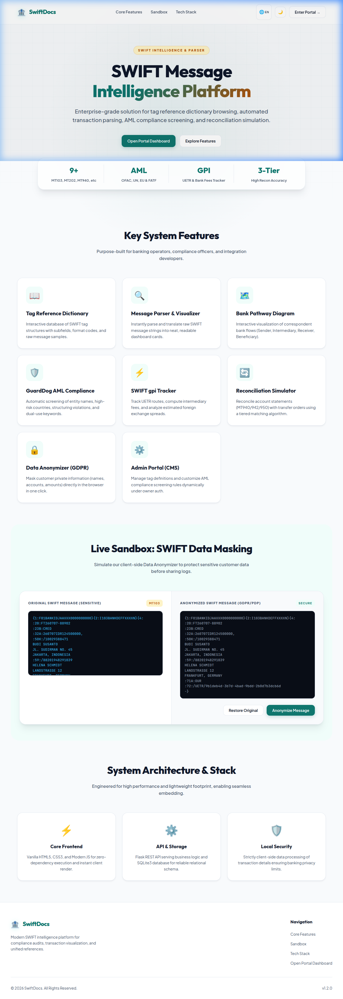

# 🏦 SWIFT Intelligence Hub & Reporting Tool

An enterprise-grade, lightweight web portal for parsing, visualising, and managing SWIFT message types, with a built-in compliance screening engine, gpi transaction tracker, and multi-tiered reconciliation simulator.



---

## 🚀 Key Modules

### 1. 🌐 Landing Page (Entry Point)
* **Interactive Sandbox**: Live client-side SWIFT Anonymizer demo to mask sensitive data (GDPR / UU PDP compliant) in real-time.
* **Theme & i18n Sync**: Seamless light/dark mode and bilingual support (Indonesian / English) synced via `localStorage` directly to the portal dashboard.

### 2. 🏠 Portal Dashboard & Reference Dictionary
* **Quick-Access Cards**: Visual summary for MT103, MT202, MT940, MT942, MT950, MT564, and others.
* **Comprehensive Dictionary**: Browse, filter, and sort SWIFT tags with structured subfield specifications, validation rules, and raw samples.

### 3. 🔍 Raw SWIFT Parser & Visualizer
* **Supported Types**: MT101, MT102, MT103, MT104, MT202, MT564, MT910, MT940, MT942, and MT950.
* **Interactive Bank Pathway**: Generates flowcharts mapping the correspondent bank chain (Sender, Intermediary, Receiver, Beneficiary) with detailed entity inspector panels.
* **SWIFT gpi Tracker**: Tracks UETR hops, processing status (ACSC, ACSP, HOLD, RJCT), and calculates bank fees and FX spreads.

### 4. 🛡️ GuardDog Compliance Engine (AML)
* **Real-Time Screening**: Scans transactions, BICs, and descriptions against sanctions lists (OFAC, UN, EU), high-risk FATF jurisdictions, and AML structuring thresholds (e.g. transactions approaching $10,000).

### 5. 🔄 Reconciliation Simulator
* **Tiered Matching Engine**: Matches customer statements (MT940/942/950) with payment messages using three match tiers: Exact, Partial, and Amount-only (within a configurable tolerance).

### 6. 🛠️ Admin CMS Portal (Direct URL Access)
* **Full CRUD Management**: Create, edit, and deactivate SWIFT tags or update active compliance screening rules.
* **Bulk Data Operations**: Paste and validate LLM-generated JSON for quick database updates.

---

## 🛠️ Tech Stack

| Layer | Technologies |
|---|---|
| **Frontend** | HTML5, Vanilla CSS3, ES6+ JavaScript (zero external dependencies), Chart.js |
| **Backend** | Python 3.10+, Flask API, SQLite3 |
| **Database Schema** | Relational schema with a composite unique key `(msg, tag, sub)` for tag variation support |

---

## 📁 Project Structure

```
SWift Statement/
├── index.html                    # Landing Page (Entry Point)
├── home.html                     # Main Portal Dashboard (SPA)
├── admin.html                    # Admin Portal / CMS (Direct Access)
├── swift-data.json               # Seed data for offline fallback
├── assets/
│   └── landing_page.png          # Landing page screenshot
├── backend/
│   ├── app.py                    # Flask REST API server (port 8766)
│   ├── init_db.py                # Database initialization script
│   ├── schema.sql                # SQLite DDL schema
│   └── swift.db                  # SQLite database
└── scripts/                      # DB setups & data scraper scripts
```

---

## 🚀 Quick Start

### 1. Initialize the Database
```bash
cd backend
python3 init_db.py
python3 ../scripts/setup_compliance_db.py
```

### 2. Launch the Application
Start both the Flask Backend and Python HTTP Frontend server concurrently with a single command:
```bash
./start.sh
```
Or using python launcher directly:
```bash
python3 start.py
```
Open **`http://localhost:8765`** in your browser.

---

## 🔌 Core API Endpoints

### SWIFT Tag Dictionary
* `GET /api/tags` - Retrieve active tags (system + custom merged view).
* `POST /api/tags` - Upsert a single tag composite record.
* `POST /api/tags/import` - Bulk import tags via array of JSON objects.
* `DELETE /api/tags/<msg>/<tag>/<sub>` - Deactivate (soft-delete) a tag.

### Compliance Rules
* `GET /api/compliance/rules` - Retrieve active AML/sanctions rules.
* `POST /api/compliance/rules` - Create or update a compliance rule.
* `DELETE /api/compliance/rules/<id>` - Deactivate/soft-delete a rule.
